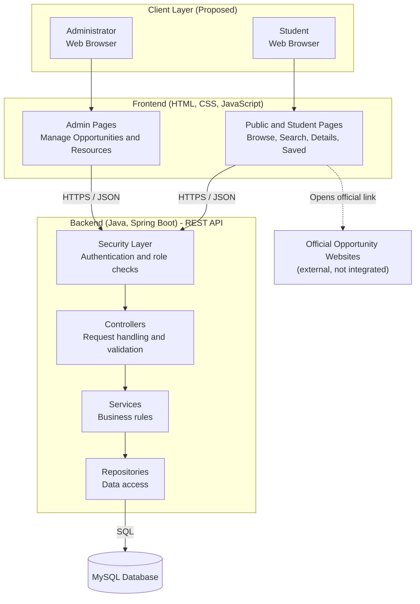
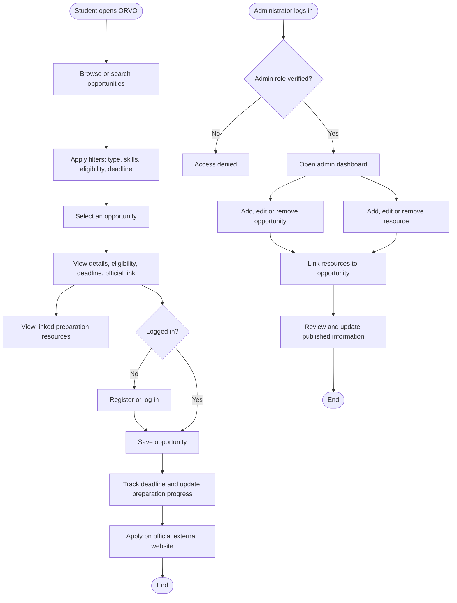
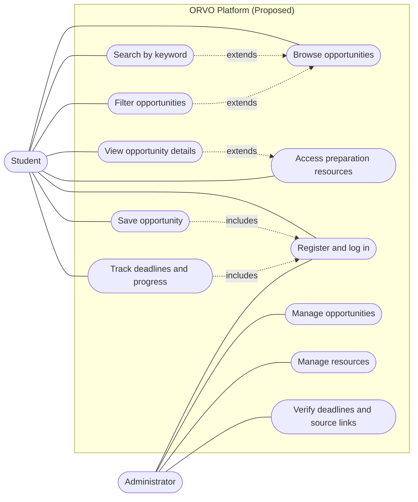
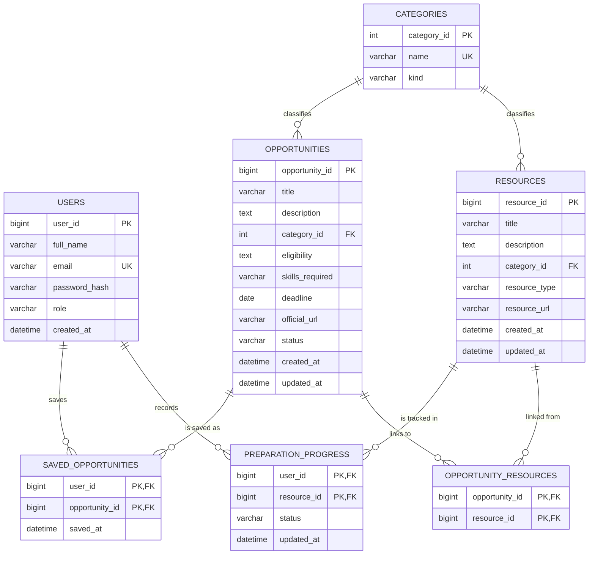

# 03 – System Design

*Proposed design. None of the components, endpoints or tables below exist yet.*

## 1. High-Level Architecture

ORVO is proposed as a three-tier web application: a browser-based **frontend** (HTML, CSS, JavaScript), a **backend** REST API (Java, Spring Boot) and a **MySQL** database. The backend is layered into security, controllers, services and repositories. Official opportunity websites are reached only through links opened by the user's browser.

Diagram source: [architecture.mmd](diagrams/architecture.mmd)

**Plain-language explanation:** students and administrators use a browser. The frontend pages call the backend over HTTPS. The security layer checks who is calling and what they may do; controllers validate requests; services apply the rules; repositories read and write MySQL. The dotted line shows that ORVO only links to official sites.

## 2. Component Responsibilities

| Component | Responsibility |
|---|---|
| Frontend pages | Render data, collect input, call API, basic client-side validation (convenience only) |
| Security layer | Authenticate users, enforce STUDENT/ADMIN roles |
| Controllers | Map HTTP requests to services, validate input, shape JSON responses |
| Services | Business rules (e.g. only published items visible, no duplicate saves, expiry marking) |
| Repositories | Database queries and persistence |
| MySQL | Durable storage with integrity constraints |

## 3. Main User Journeys

### 3.1 Opportunity discovery and filtering
Student opens listing → API returns published opportunities → student enters keywords and/or filters (type, skills, eligibility, deadline) → API returns matching items → results show title, category, deadline and expiry mark.

### 3.2 Detail and preparation resources
Student selects an opportunity → API returns details and linked resources → student reads eligibility and deadline, opens resources, or follows the official link in a new tab.

### 3.3 Saving and tracking
Student logs in → saves an opportunity (unique per user) → "Saved" page lists items by deadline → student sets resource status (not started / in progress / completed).

### 3.4 Administrative content management
Administrator logs in (role verified server-side) → creates or edits an opportunity as DRAFT → links resources → verifies deadline, eligibility and source link → publishes. Outdated items are archived.

## 4. Workflow Diagram

Source: [workflow.mmd](diagrams/workflow.mmd)

## 5. Use Cases and Actors

Source: [use_case.mmd](diagrams/use_case.mmd). Actors: Student (visitor before login) and Administrator.

Mermaid has no native UML use-case notation, so a flowchart is used as an equivalent.

## 6. Proposed API Responsibilities (examples)

| Method and path | Purpose | Access |
|---|---|---|
| `GET /api/opportunities?q=&category=&skill=&deadlineBefore=` | List/search/filter published opportunities | Public |
| `GET /api/opportunities/{id}` | Details with linked resources | Public |
| `GET /api/resources?q=&type=` | List/search resources | Public |
| `POST /api/auth/register`, `POST /api/auth/login` | Account creation, login | Public |
| `GET/POST/DELETE /api/me/saved` | List, save, unsave opportunities | Student |
| `PUT /api/me/progress/{resourceId}` | Set preparation status | Student |
| `POST/PUT/DELETE /api/admin/opportunities[/{id}]` | Manage opportunities | Admin |
| `POST/PUT/DELETE /api/admin/resources[/{id}]` | Manage resources | Admin |
| `PUT/DELETE /api/admin/opportunities/{id}/resources/{resourceId}` | Link/unlink | Admin |

Paths are illustrative and may change during implementation.

## 7. Proposed Database Design

Source: [database_er.mmd](diagrams/database_er.mmd). A relational database is justified because the data is structured and has clear many-to-many relationships.

**Allowed values (proposed):** `USERS.role` = STUDENT or ADMIN; `CATEGORIES.kind` = OPPORTUNITY or RESOURCE; `OPPORTUNITIES.status` = DRAFT, PUBLISHED or ARCHIVED; `RESOURCES.resource_type` = TUTORIAL, PRACTICE, GUIDE or MATERIAL; `PREPARATION_PROGRESS.status` = NOT_STARTED, IN_PROGRESS or COMPLETED.

**Relationships and decisions**

- *Opportunity ↔ Resource is many-to-many* (one guide can help several opportunities), hence the link table `OPPORTUNITY_RESOURCES`.
- *SavedOpportunity* has a composite key (user, opportunity), which enforces BR-03 at database level.
- *PreparationProgress* is tracked per user and **resource**, because preparation happens on resources, not on opportunities. An opportunity's overall readiness can be derived from its linked resources.
- *Category* is shared by opportunities and resources through a `kind` field, avoiding two near-identical tables. Alternative: separate tables (simpler constraints, more tables).
- *Skills* are stored as a text field in the MVP for simplicity; a normalised `SKILLS` table is a possible later improvement if filtering needs it.
- No separate Administrator table: `role` on USERS is sufficient.

## 8. Data Flow

Browser → (JSON/HTTPS) → security check → controller validation → service rules → repository → MySQL; results travel back as JSON and are rendered by the frontend with output encoding.

## 9. Error Handling

| Situation | Proposed response |
|---|---|
| Invalid input | 400 with field-level messages |
| Not logged in | 401, prompt to log in |
| Not permitted | 403 |
| Item not found | 404 with friendly message |
| Duplicate (e.g. e-mail, saved item) | 409 |
| Unexpected failure | 500 with a generic message; details only in server logs |

## 10. Security Boundaries

Browser is untrusted; all validation and authorisation are repeated server-side. The database is reachable only from the backend. Secrets live outside the repository. See [05 Security and Test Plan](05_Security_and_Test_Plan.md).

## 11. Scalability and Maintainability

The MVP targets modest load. Layered code, a stateless API, indexed search columns and pagination of lists allow later growth. Full-text search, caching or a separate frontend framework are possible later changes, not MVP commitments.

## 12. Assumptions and Trade-offs

| Decision | Benefit | Trade-off |
|---|---|---|
| Manual content curation | Reliable, no scraping legality/maintenance issues | Admin effort; data may go stale |
| Plain HTML/CSS/JS | Simple, known to the team | More manual work than a framework |
| Single backend (monolith) | Easy to build and deploy | Less independent scaling |
| Link to official sites | Avoids handling applications | Users leave ORVO to apply |
